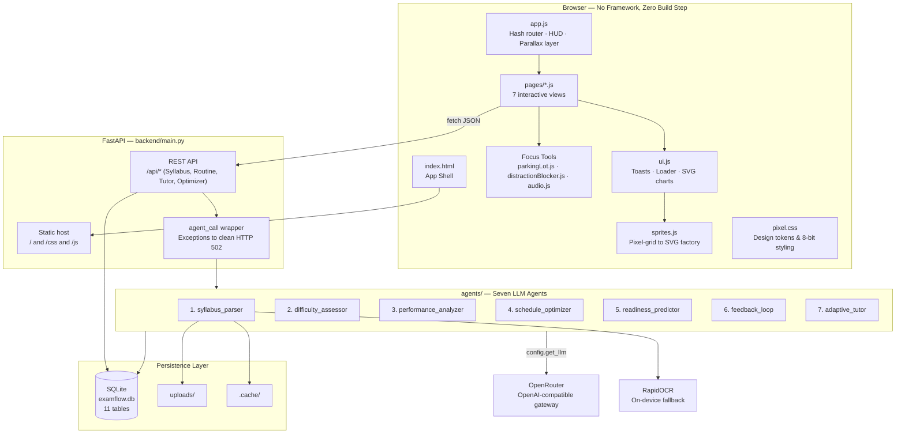
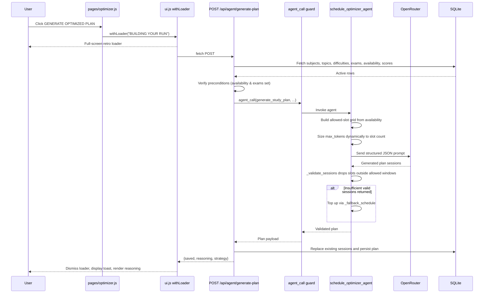
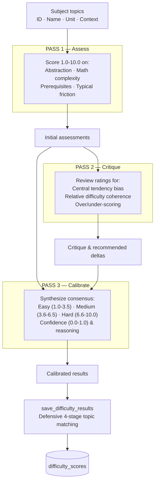
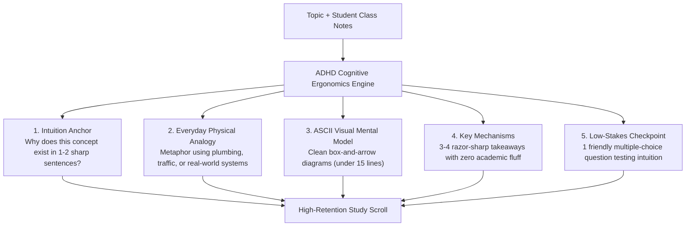
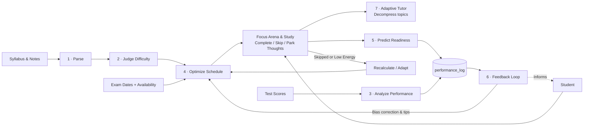
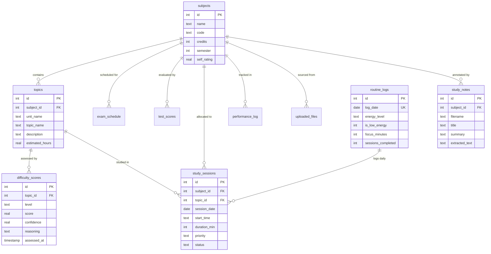

# SADHANA – Your Personalised Academic Companion

SADHANA is an AI-powered, ADHD-inclusive learning and academic support platform designed specifically for university students with ADHD.

It aims to make studying more manageable through personalised learning experiences, adaptive AI tutoring and intelligent academic planning. SADHANA breaks complex subjects into smaller, understandable concepts, provides interactive practice and adapts explanations based on each student's learning progress.

With features such as flexible focus sessions, a Thought Parking Lot for capturing distracting thoughts, adaptive study planning and personalised progress tracking, SADHANA helps students organise their academic lives and approach learning at their own pace.

Inspired by the principles of mindfulness, discipline and self-awareness, SADHANA brings together technology and thoughtful learning strategies to create a more supportive academic environment.

**Our vision is simple: Make learning more accessible, manageable and personalised, one concept at a time.**

FastAPI backend · SQLite · OpenRouter · an 8-bit arcade frontend with ADHD cognitive ergonomics, ambient focus audio, and zero build step.

---

## Contents

- [Quick start](#quick-start)
- [Configuration](#configuration)
- [System architecture](#system-architecture)
- [Request lifecycle](#request-lifecycle)
- [The seven agents](#the-seven-agents)
  - [1. Syllabus Parser](#1-syllabus-parser)
  - [2. Difficulty Assessor](#2-difficulty-assessor--llm-as-judge)
  - [3. Performance Analyzer](#3-performance-analyzer)
  - [4. Schedule Optimizer](#4-schedule-optimizer)
  - [5. Readiness Predictor](#5-readiness-predictor)
  - [6. Feedback Loop](#6-feedback-loop)
  - [7. ADHD Adaptive Tutor](#7-adhd-adaptive-tutor)
- [ADHD & Neurodivergent Focus Suite](#adhd--neurodivergent-focus-suite)
  - [Thought Parking Lot](#thought-parking-lot)
  - [Focus Shield & Distraction Blocker](#focus-shield--distraction-blocker)
  - [Sensory Audio Engine](#sensory-audio-engine)
  - [Low-Energy Day Dynamic Adaptation](#low-energy-day-dynamic-adaptation)
- [The closed loop](#the-closed-loop)
- [Data model](#data-model)
- [API reference](#api-reference)
- [Frontend architecture](#frontend-architecture)
- [Project layout](#project-layout)
- [Extending it](#extending-it)
- [Performance and cost](#performance-and-cost)
- [Troubleshooting](#troubleshooting)
- [Known limitations](#known-limitations)

---

## Quick start

```bash
pip install -r requirements.txt
cp .env.example .env          # paste your OpenRouter key into it
python run.py                 # -> http://127.0.0.1:8000
```

On Windows, if `python` resolves to the `C:\Windows\System32\python` stub, use the launcher:

```powershell
py -3 run.py
```

The app works without an API key — you can add subjects, set exams, build the availability
grid, track routines, use the sensory audio engine, and test the thought parking lot. Only the
AI buttons need the key, and they provide helpful inline guidance when it's missing rather than
failing silently.

**First run, in order:** Setup → add subjects · Setup → upload a syllabus · Syllabus → run
the difficulty assessment · Schedule → set exam dates and availability · Optimizer →
generate the plan · Arena → launch your focus session with brown noise and the Thought Parking Lot.

Or hit **LOAD DEMO SAVE** on the landing page to seed subjects with topics, difficulty scores,
and initial data.

### Before a live demo

```bash
python prewarm.py     # parse every file in uploads/ into the cache
```

Uploads of those files then return in ~0.2s instead of 6–18s, and they won't fail during a
presentation due to a flaky network. `python prewarm.py --clear` empties the cache.

Two other things worth doing beforehand: narrow your **availability** windows (a 06:00–20:00
grid produces 11 sessions a day and a 50s plan generation; 3–4 hours a day is realistic and
much faster), and run the difficulty assessment once so the radar chart has data.

---

## Configuration

Everything lives in `.env` (gitignored). `config.py` loads it via `python-dotenv` before
anything reads `os.environ`.

| Variable | Default | Purpose |
| --- | --- | --- |
| `OPENROUTER_API_KEY` | — | Required for the AI agents. Everything else works without it. |
| `EXAMFLOW_MODEL` | `openai/gpt-4o-mini` | Any OpenRouter model ID. Must support `response_format: json_object`. |
| `OPENROUTER_BASE_URL` | `https://openrouter.ai/api/v1` | Swap for a different OpenAI-compatible gateway. |
| `EXAMFLOW_MAX_OUTPUT_TOKENS` | `16000` | Output ceiling for the schedule optimizer. |
| `EXAMFLOW_VISION` | `1` | Send images directly to the multimodal model. `0` forces offline RapidOCR. |
| `EXAMFLOW_CACHE` | `1` | Cache parsed documents by SHA-256 hash in `.cache/`. |
| `OPENROUTER_APP_NAME` / `OPENROUTER_SITE_URL` | `SADHANA` / localhost | Attribution headers shown on your OpenRouter dashboard. |
| `EXAMFLOW_HOST` / `EXAMFLOW_PORT` | `127.0.0.1` / `8000` | Server bind host and port. |
| `EXAMFLOW_OPEN` | `1` | Set `0` to prevent opening the browser automatically on launch. |

### Choosing a model

The agents emit deeply nested JSON, so the model must be reliable under
`response_format: json_object`. Verified options:

| Model | Prompt / Completion per 1M | Notes |
| --- | --- | --- |
| `mistralai/mistral-small-3.2-24b-instruct` | $0.075 / $0.20 | Cheapest model that reliably maintains schema compliance. |
| `meta-llama/llama-3.3-70b-instruct` | $0.10 / $0.32 | High reasoning accuracy on schedule constraints. |
| **`openai/gpt-4o-mini`** *(default)* | **$0.15 / $0.60** | Best reliability-to-cost ratio for the 3-pass judge and tutor. |
| `google/gemini-2.5-flash` | $0.30 / $2.50 | Strongest multimodal syllabus parsing. |

---

## System architecture



**Architectural separation:** `agents/` and `db/` contain pure Python logic independent of HTTP,
while the frontend communicates solely via clean JSON endpoints. `backend/main.py` serves as the
single integration bridge between the database, the agent orchestration layer, and the static UI.

---

## Request lifecycle

All agent-powered flows follow an orchestrated sequence. For example, during study plan optimization:



---

## The seven agents

Every agent lives in `agents/`, operates as a standalone function, and obtains its model via
`config.get_llm(temperature, max_tokens, json_mode)`.

| # | Agent | Pattern | LLM calls | Deterministic fallback |
| --- | --- | --- | --- | --- |
| 1 | Syllabus Parser | Chain-of-thought extraction | 1 | Empty unit list with reasoning error |
| 2 | Difficulty Assessor | **LLM-as-Judge (3 passes)** | 3 | Pass-1 results, else fallback to `medium` @ 0.3 |
| 3 | Performance Analyzer | Comparative analysis | 1 | Threshold-based score arithmetic |
| 4 | Schedule Optimizer | Constraint-aware planning | 1 | Round-robin slot filler |
| 5 | Readiness Predictor | Chain-of-thought scoring | 1 per subject | Weighted formula with hard-topic penalties |
| 6 | Feedback Loop | Meta-analysis | 2 | Mean absolute error per subject |
| 7 | **ADHD Adaptive Tutor** | **High-grasp cognitive scaffolding** | 1 | Pre-formatted intuition anchor & ASCII mental model |

---

### 1. Syllabus Parser

`agents/syllabus_parser_agent.py` — transforms syllabi and past exam papers into structured units,
topics, and estimated revision durations.

- **Multimodal Vision:** Image uploads are routed directly to the multimodal model, preserving
  table formatting and reading complex text in 6–18s (compared to 40–90s via CPU-bound OCR).
- **Offline OCR Fallback:** RapidOCR executes locally when offline or when `EXAMFLOW_VISION=0`.
- **Content-Addressable Cache:** Documents are indexed by SHA-256 hash in `.cache/`. Re-uploaded files
  resolve in ~0.2s without making model requests.

---

### 2. Difficulty Assessor — LLM-as-Judge

`agents/difficulty_assessor_agent.py` — runs a multi-pass evaluation to mitigate central-tendency bias:



---

### 3. Performance Analyzer

`agents/performance_analyzer_agent.py` — translates real test performance (such as CIE scores) into
dynamically weighted study allocations:

- Banding: `<60%` (High Priority), `60–75%` (Medium Priority), `>75%` (Reduced Priority).
- Cross-referencing: Flags high-difficulty topics with poor scores as critical areas, and detects
  anomalies where students struggle with foundational topics.

---

### 4. Schedule Optimizer

`agents/schedule_optimizer_agent.py` — generates a comprehensive timetable enforcing nine strict constraints:

1. Adherence only to designated user availability windows.
2. Complete exclusion of days marked `NOT AVAILABLE`.
3. Standard 60-minute revision blocks separated by 15-minute cognitive breaks.
4. Placement of difficult topics during user-designated peak energy hours.
5. Spacing revisions across multiple days (spaced repetition).
6. Preserving a 2–3 day buffer prior to exams for final review.
7. Distributing subjects evenly within each study day.
8. Prioritizing subjects with upcoming exams or low continuous assessment scores.
9. Full utilization of free availability slots.

#### Dynamic Recalculation (`recalculate_after_skip`)

When sessions are marked skipped, recalculation preserves completed milestones and rebooks
only the missed topics into future open slots, verified against current availability windows.

---

### 5. Readiness Predictor

`agents/readiness_predictor_agent.py` — evaluates exam preparedness per subject based on:

- Topic coverage percentage (verified against completed sessions).
- Weighted score trends across past tests.
- Session completion rates.
- Uncovered difficult topics.
- Days remaining until the scheduled exam date.

---

### 6. Feedback Loop

`agents/feedback_loop_agent.py` — evaluates the accuracy of the platform's own predictions:

- Computes signed errors between predicted readiness and actual exam outcomes.
- Detects systematic bias (over-confidence vs. under-confidence).
- Generates actionable habit adjustments categorized by time management, study technique, and focus.

---

### 7. ADHD Adaptive Tutor

`agents/adaptive_tutor_agent.py` — designed specifically for neurodivergent learning patterns and cognitive clarity:



- **Material Compression (`/api/tutor/compress`):** Condenses dense textbook chapters and uploaded
  handwritten notes into an intuitive study scroll.
- **Grounding in Student Notes:** Extracts context from student-uploaded class notes (`study_notes` table)
  so explanations reuse the specific terminology taught in lectures.
- **Socratic Quick Helper (`/api/tutor/ask`):** Provides instant, supportive answers capped at 70 words
  during active focus sessions to unblock stuck students without derailing concentration.

---

## ADHD & Neurodivergent Focus Suite

SADHANA includes dedicated tools designed for executive function support, hyperfocus management, and energy fluctuations:

### Thought Parking Lot
- **Location:** Accessible globally from the navigation bar (`parkingLot.js`).
- **Function:** When intrusive thoughts or tangential tasks arise during a study session, students can
  quickly park them without opening separate apps.
- **Persistence:** Stored in browser `localStorage`, with unread badge indicators and instant clearing once addressed.

### Focus Shield & Distraction Blocker
- **Location:** Focus Arena & Settings (`distractionBlocker.js`).
- **Function:** Manages distraction-blocking preferences across 12+ common social and entertainment platforms
  (Instagram, YouTube, Discord, Reddit, TikTok).
- **Platform Integration:** Prompts Android Focus Mode triggers on mobile browsers and provides active visual
  warning shields during study intervals on desktop.

### Sensory Audio Engine
- **Location:** Focus Arena (`audio.js`).
- **Function:** Real-time ambient sound generation using the native **Web Audio API** (zero external sound files or streaming bandwidth required).
- **Audio Modes:**
  - **Brown Noise:** Deep, rumbling low-frequency noise optimized for masking distractions and sustaining attention.
  - **Rain Texture:** Soft pink/white noise filtered to simulate natural rainfall.
  - **Binaural Pulse:** 40 Hz gamma beat frequency to encourage cognitive focus.
- **Persistence:** Selected mode and volume levels persist across reloads.

### Low-Energy Day Dynamic Adaptation
- **Location:** Today's Routine (`/api/routine/energy` & `/api/routine/adapt`).
- **Function:** Students can toggle **Low Energy Mode** on difficult days.
- **Behavior:** The optimizer dynamically reduces session volume, postpones high-difficulty topics,
  and spreads workloads across subsequent days to maintain momentum without burnout.

---

## The closed loop



---

## Data model

The SQLite database (`examflow.db`) contains 11 relational tables managed in `db/schema.sql`:



---

## API reference

Full interactive OpenAPI documentation is available at **`/docs`** when the server is running.

### Core Data & Schedule Endpoints

| Method | Path | Description |
| --- | --- | --- |
| `GET` | `/api/health` | Service health, model status, and capability flags |
| `GET` | `/api/stats` | High-level counters for the retro HUD |
| `POST` | `/api/seed` | Seed demo curriculum, exams, and difficulty ratings |
| `GET` `POST` | `/api/subjects` | List or create academic subjects |
| `DELETE` | `/api/subjects/{id}` | Delete subject (cascades through child tables) |
| `GET` `POST` | `/api/topics` | Query or insert syllabus topics |
| `GET` | `/api/subjects/{id}/topics` | Fetch topics with calibrated difficulty scores attached |
| `GET` | `/api/difficulties` | Retrieve latest difficulty evaluation per topic |
| `GET` `POST` | `/api/exams` | Query upcoming exams or upsert target exam dates |
| `POST` | `/api/exams/{id}/complete` | Mark an exam as finished |
| `GET` `PUT` | `/api/availability` | Fetch or replace the weekly study availability window |
| `GET` `POST` | `/api/scores` | Log test results (CIEs, quizzes, midterms) |
| `GET` | `/api/sessions` | Retrieve scheduled study sessions |
| `POST` | `/api/sessions/{id}/status` | Update session status (`planned`, `completed`, `skipped`) |
| `DELETE` | `/api/sessions` | Reset the current revision timetable |

### AI Agent Endpoints

| Method | Path | Description |
| --- | --- | --- |
| `POST` | `/api/upload` | Process syllabus documents and extract structured units |
| `POST` | `/api/agent/assess-difficulty` | Run 3-pass LLM-as-Judge difficulty calibration |
| `POST` | `/api/agent/analyze-performance` | Evaluate test scores and rebalance subject priorities |
| `POST` | `/api/agent/generate-plan` | Generate timetable adhering to constraints |
| `POST` | `/api/agent/recalculate-plan` | Reallocate skipped sessions into upcoming available slots |
| `POST` | `/api/agent/predict-readiness` | Generate readiness forecasts and spot critical gaps |
| `POST` | `/api/agent/insights` | Run meta-evaluations and generate feedback guidance |

### ADHD & Routine Endpoints

| Method | Path | Description |
| --- | --- | --- |
| `POST` | `/api/tutor/compress` | Generate an ADHD-friendly cognitive study scroll |
| `POST` | `/api/tutor/ask` | Fast Socratic question answering (<70 words) |
| `GET` | `/api/subjects/{id}/notes` | Fetch extracted lecture notes by subject |
| `GET` | `/api/routine/today` | Fetch or initialize today's routine metrics |
| `POST` | `/api/routine/energy` | Set low-energy day status and energy level |
| `POST` | `/api/routine/focus` | Record focus session minutes into daily tracking |
| `POST` | `/api/routine/adapt` | Adapt timetable specifically for low-energy days |
| `GET` | `/api/routine/stats` | Retrieve cumulative streak and focus session statistics |

---

## Frontend architecture

The frontend is built with pure ES modules, CSS variables, and HTML5 canvas/SVG. It requires
no React, Vite, Webpack, or npm dependencies.

### Design System: 8-Bit Arcade
- **Typography:** `Press Start 2P` for arcade headings and badges; `VT323` at 21px for body copy.
- **Palette:** Classic arcade palette (`--paper: #FDF6E3`, `--ink: #1A1A2E`, `--blue: #2A6FDB`, `--red: #E63946`, `--yellow: #FFC94A`, `--green: #3FA34D`).
- **Icons & Sprites:** Procedurally compiled SVG rects generated via character grids in `sprites.js` with zero image asset overhead.
- **Charts:** Lightweight, crisp SVG visualizers in `ui.js` (radar chart, bar charts, step-line charts, stat meters).

### Navigation Routes

| Route | Module | Purpose |
| --- | --- | --- |
| `#/` | `pages/home.js` | Landing page with scrollytelling introduction |
| `#/setup` | `pages/setup.js` | Manage subjects, upload syllabi, and load saves |
| `#/syllabus` | `pages/syllabus.js` | Topic outline, difficulty radar, judge evaluations |
| `#/schedule` | `pages/schedule.js` | Exam countdowns and weekly availability grid |
| `#/performance` | `pages/performance.js` | Test score tracking, progress analysis, and insights |
| `#/optimizer` | `pages/optimizer.js` | Timetable map, Focus Arena, Adaptive Tutor, and recalculation |
| `#/feedback` | `pages/feedback.js` | Prediction accuracy analysis and study recommendations |

---

## Project layout

```
run.py                      Launcher — boots FastAPI on uvicorn and opens browser
prewarm.py                  Caches document parses from uploads/ ahead of time
config.py                   Paths, palette definitions, and OpenRouter LLM setup
.env                        Local secrets (gitignored) · .env.example template

backend/
  main.py                   REST API endpoints and static frontend hosting

agents/                     Seven decoupled LLM agents (pure Python)
  syllabus_parser_agent.py      Extracts units/topics with multimodal vision support
  difficulty_assessor_agent.py  3-pass LLM-as-Judge difficulty calibration
  performance_analyzer_agent.py Translates test scores to subject priority shifts
  schedule_optimizer_agent.py   Constraint-satisfying study plan generator
  readiness_predictor_agent.py  Readiness forecasting and gap identification
  feedback_loop_agent.py        Prediction accuracy evaluation & personalized advice
  adaptive_tutor_agent.py       ADHD-friendly topic decompression and Q&A

db/
  schema.sql                11 SQLite tables (subjects, routines, sessions, notes)
  database.py               Thread-safe SQLite queries and business logic

frontend/
  index.html                Lightweight single-page application shell
  css/pixel.css             8-bit arcade design tokens and layouts
  js/
    app.js                  Hash router, retro HUD, calm mode, and sound effects
    api.js                  Typed fetch client for all backend endpoints
    audio.js                ADHD sensory audio generator (Brown Noise, Rain, Binaural)
    parkingLot.js           Quick-capture thought parking lot with badge notifications
    distractionBlocker.js   Distraction app blocker and focus shield
    sprites.js              Vector pixel-art sprite rendering engine
    ui.js                   Toasts, modal dialogues, and responsive SVG charts
    pages/*.js              Page modules for each level of the app

uploads/                    Uploaded syllabi, exam schedules, and notes
examflow.db                 SQLite database
```

---

## Extending it

### Adding a new agent
1. Create `agents/my_agent.py` as a function accepting inputs and returning a dictionary.
2. Initialize models with `get_llm(temperature=..., max_tokens=..., json_mode=True)` and include a deterministic fallback.
3. Expose the agent in `backend/main.py` wrapped inside `agent_call(...)` for automatic 502 error handling.
4. Bind the endpoint in `frontend/js/api.js` and call it using `withLoader(...)` in the UI.

### Adding a sprite
Add a 2D string array to the `SPRITES` object in `frontend/js/sprites.js` using palette character mappings,
then invoke it anywhere via `sprite('mysprite', 32)`.

---

## Performance and cost

Benchmarks using the default `openai/gpt-4o-mini` on a curriculum of 6 subjects and 115 topics:

| Action | Latency | Estimated cost |
| --- | --- | --- |
| Parse text syllabus (PDF/TXT) | 5–15s | < $0.01 |
| Parse image syllabus (Vision) | 6–18s | < $0.01 |
| **Any cached document hit** | **0.1–0.4s** | **$0.00 (Free)** |
| 3-Pass difficulty assessment (11 topics) | ~30s | ~$0.01 |
| Performance analysis | ~8s | < $0.01 |
| **Generate complete plan (200+ sessions)**| **~45s** | **~$0.01** |
| Dynamic recalculation | ~20s | < $0.01 |
| Adaptive Tutor compression | ~4–8s | < $0.01 |
| Sensory Audio Engine (Brown Noise/Rain) | **Instant** | **$0.00 (Runs 100% in browser)** |

---

## Troubleshooting

- **`OPENROUTER_API_KEY is not set`**: Create a `.env` file in the project root containing `OPENROUTER_API_KEY=your_key` and restart `python run.py`.
- **Windows launcher conflicts**: If `python` opens the Windows Store, execute using `py -3 run.py` instead.
- **Audio engine produces no sound**: Web browsers require user interaction before playing audio. Click anywhere inside the Focus Arena to initialize the Web Audio context.
- **Offline OCR installation**: For offline environments without vision API access, run `pip install rapidocr-onnxruntime`.
- **Clearing the parse cache**: Run `python prewarm.py --clear` to purge cached document hashes from `.cache/`.
- **Browser caching during local development**: Use `Ctrl + F5` or `Ctrl + Shift + R` to hard-refresh unbundled JavaScript modules.

---

## Known limitations

- **Single-User Architecture:** Designed for local self-hosted execution via SQLite; multi-tenant authentication is not configured by default.
- **Local Network Exposure:** Uploaded file names and payloads are validated for local desktop use; add rigorous file-type sanitization before exposing port 8000 to public networks.
- **Plan Generation Scope:** Re-generating the schedule creates a fresh optimization run. To preserve completed session history, use the **Recalculate** or **Low Energy Adapt** features.
